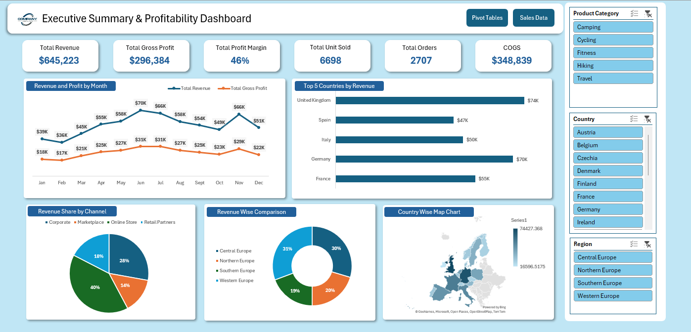
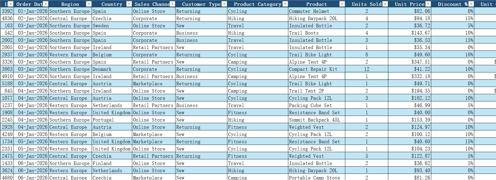

# Executive Summary & Profitability Dashboard (Excel)

An interactive Excel dashboard that summarizes sales performance and profitability across European markets.

## Dashboard Preview

## Cleaned Data Preview

## Project Files

- [Executive summary dashboard excel.xlsx](Executive%20summary%20dashboard%20excel.xlsx): the full Excel workbook
- EXECUTIVE_SUMMARY_DASHBOARD.png: dashboard screenshot
- EXECUTIVE_SUMMARY_CLEANED_DATA.png: cleaned data screenshot

## Workbook Structure

1. **Raw Data**: original sales data
2. **Cleaned Data**: data after cleaning and formatting
3. **Pivot Tables**: summaries used to build the charts
4. **Dashboard**: final interactive dashboard

## Key Metrics

| Metric | Value |
|---|---|
| Total Revenue | $645,223 |
| Total Gross Profit | $296,384 |
| Profit Margin | 46% |
| Total Units Sold | 6,698 |
| Total Orders | 2,707 |
| COGS | $348,839 |

## Dashboard Features

- KPI cards for revenue, profit, margin, units, orders and COGS
- Revenue and profit trend by month
- Top 5 countries by revenue
- Revenue share by sales channel
- Revenue comparison by region
- Country-wise map chart
- Slicers for Product Category, Country and Region

## Key Insights

- The business earns a healthy 46% profit margin, and it stays steady across the year.
- Revenue peaked in June (about $70K) and again in November (about $66K).
- Revenue dipped in October, so that month needs attention.
- Germany and the UK are the top revenue-generating countries.
- Profit moves in line with revenue, so growth comes mainly from sales volume.

## Conclusion

The business is profitable and performs best in mid-year and November. Promotions in the weaker months and growth in smaller channels and regions could increase revenue further.

## Data Cleaning Steps

- Removed duplicate records
- Handled blank and missing values
- Fixed data types and date formats
- Standardized column names

## Tools Used

- Microsoft Excel
- Pivot Tables and Pivot Charts
- Slicers
- Data Cleaning
- Dashboard Design

## Author

**Sajjal Ishtiaq**
GitHub: [sajjalishtiaq-sys](https://github.com/sajjalishtiaq-sys)
